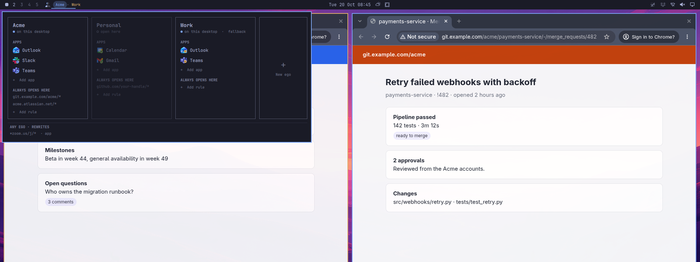
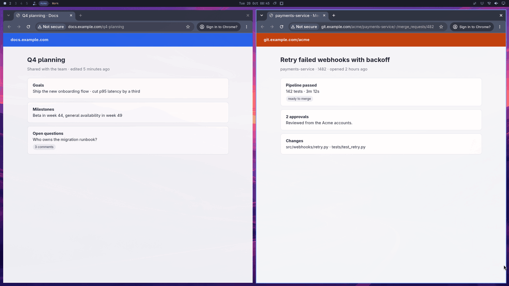
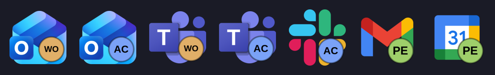
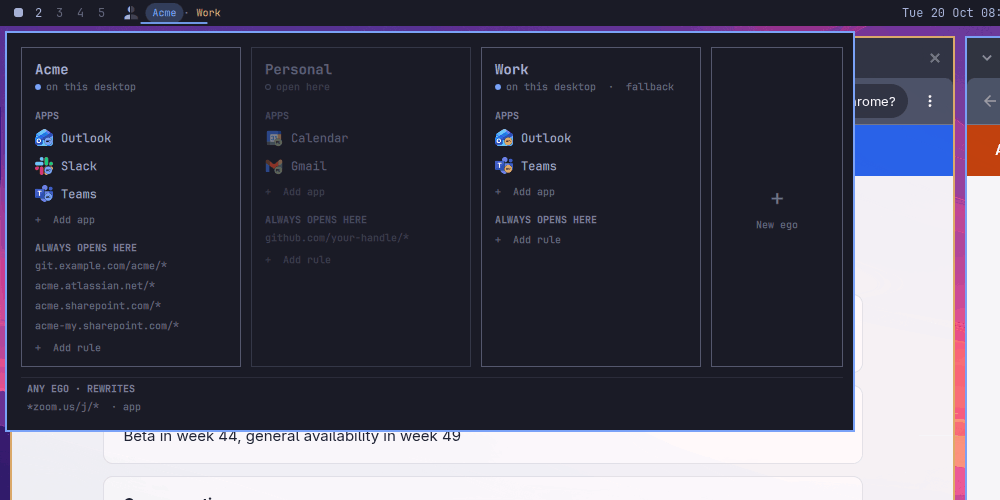

# omaego

**One browser identity per context, side by side on your desktop. Every link
opens in the right one.**

Your employer, two customers and your private life each want their own
Microsoft or Google login, cookies, extensions and bookmarks. Chrome profiles
almost get you there, until a link you click outside the browser opens in
whichever profile you touched last, and the customer's SharePoint greets you as
the wrong person.

omaego gives each context its own **ego**, a fully separate browser profile with
its own colour, and routes every link you click to the one it belongs to. It is built
for [Omarchy](https://omarchy.org) and Hyprland.



- **Links land in the right place.** A link opens in the ego that owns the
  workspace you are on, as a tab in a window that ego already has there. It never
  pulls you onto another desktop.
- **Customer URLs know their owner.** `acme.sharepoint.com` belongs to Acme
  wherever you click it. omaego asks once, then remembers.
- **Web apps for each ego.** Outlook for Work and Outlook for Acme are two
  launcher entries and two windows, each signed in to its own account, each
  badged with its ego.
- **You can see who owns what.** The bar shows which ego owns the workspace you
  are on. Open the panel, and every window is outlined in its ego's colour.
- **The same egos on every machine.** Keep your rules, egos and web apps in a
  private git repo. One click syncs them, and the default agent writes the
  commits and resolves conflicts. See [Your egos in a private
  repo](#your-egos-in-a-private-repo).
- **Agent sessions on any machine.** Pin a herdr session, any TUI or an agent
  gateway (OpenClaw, Hermes) on any machine on your tailnet to an ego. It opens
  directly where it runs and over ssh everywhere else, and reconnects when the
  connection drops. See [Sessions and gateways on your
  machines](#sessions-and-gateways-on-your-machines).
- **Truly separate.** Each ego is its own browser `--user-data-dir`, with its own
  process, cookie jar, extensions and Google sync account. Logins and cookies
  are never shared between egos.

## Links that find their way

Click a link outside the browser: in a terminal, an editor, a PDF. If it names an
account (a SharePoint tenant, an Atlassian site, an Azure DevOps organisation),
omaego asks which ego it belongs to and offers to remember the answer. Every
other link opens in the ego of the workspace you clicked it from.



## The same app, once per ego

```bash
omaego app add work outlook teams
omaego app add acme outlook teams slack
```

Each web app is its own window, signed in as that ego, and its launcher icon
carries the ego's badge. Type "outlook" in the launcher, and you get every
tenant's Outlook at once.



## Everything from the bar

The [bar widget](https://github.com/lcorneliussen/omaego-bar) names the egos on
the current workspace. A pill marks the ego that owns the focused window.
Clicking it opens a card for every ego: launch its browser or one of its web
apps here, add an app from the catalogue or from any URL, and see the routing
rules.



## Get started

Everything, in one chain pinned to a reviewed commit:

```bash
git clone https://github.com/lcorneliussen/omaego && \
  cd omaego && \
  git checkout 10567774e383b85f015c90aacfa01697a2fffcf6 && \
  ./install.sh --with-plugin && \
  omaego setup && \
  omarchy restart shell
```

Then make your first ego and sign in:

```bash
omaego add "Acme"            # its own browser profile, colour and window class
omaego launch acme           # sign in to Google/Microsoft in the window it opens
```

It needs Omarchy, Hyprland, and Chrome, Chromium or another Chromium-family
browser ([details](#requires)). Packaging,
the widget on its own, and running from a checkout are covered under
[Install](#install).

---

The rest of this README is the reference.

```
omaego list                     # the egos you have
omaego space                    # which ego owns this workspace
omaego add "Acme"               # a new ego (or: omaego new, or the bar panel)
omaego <url>                    # what the desktop entry calls
```

There is deliberately **no "active ego"**. An ego is not a mode you switch the
system into; it is an identity that happens to have windows on a workspace. A
workspace usually belongs to one ego, and links resolve inside the workspace
they were clicked from.

## Vocabulary

| term | means |
|---|---|
| **ego** | one identity: its own Chrome `--user-data-dir`, window class, cookie jar, extensions and sync account |
| **ego card** | one ego's row in the bar panel — its colour chip, name, web apps, and the actions that apply to it *on the current workspace* (`+app`, `✕`) |
| **the mark** | the split-person icon in the bar; the label beside it names the egos on this workspace |
| **the panel** | the popout from the mark, listing every ego card and the rules |
| **pill** | the tint behind an ego's name in the bar when it owns the focused window |
| **badge** | the ego-coloured disc stamped bottom right on a web app's icon |
| **fallback ego** | the one that owns plain "Google Chrome" and web apps launched without an ego. Not an "active" ego — there is no such thing |

## Setting up an ego

```bash
omaego add "Acme"            # a new --user-data-dir, its own class, own sync
omaego launch acme           # sign in to Google/Microsoft in the window it opens
omaego app add acme teams outlook
omaego rule add 'https://acme.atlassian.net/*' Acme
```

To make the profile your browser already has into an ego, as it is and
without copying anything:

```bash
omaego add "Personal" --existing     # also what "New ego" in the panel offers
```

It becomes the fallback ego. Restart the browser once afterwards so its windows
carry the ego's class.

Each ego runs in one browser, shown on its card. `omaego add "Acme"
--browser=brave` picks another than the default; `omaego engine acme chromium`
(or the browser row on the card) moves an ego later, backing up what it held.

`omaego add` prints those next steps for you. Nothing else on the machine shares
that ego's cookies, extensions or sync account.

To lift an existing Chrome-internal profile out into its own ego (keeping its
history, bookmarks and logins), quit Chrome fully and:

```bash
omaego import google-chrome          # lists what is inside
omaego import google-chrome "Acme"   # copies it out; the original stays as a rollback
```

## How a link is routed

1. **A rule in `~/.config/omaego/rules.toml`** → that ego, forced.
2. **A URL that names an account** — `acme.sharepoint.com`,
   `acme.atlassian.net`, `dev.azure.com/acme` — belongs to an ego rather than
   to a desktop, so omaego **asks** whose it is, then offers to remember it.
   Enter accepts "Always open … in Acme" and writes the rule; "Just this once"
   does not. The service list is built in; add suffixes of your own, one per
   line, to `~/.config/omaego/account-hosts`. `OMAEGO_NO_ASK=1` turns it off.
3. **A browser window of some ego already on this workspace** → reuse it,
   as a tab. If the workspace holds several egos, the one whose window comes
   **first in the tiling** wins — no prompt.
4. **Otherwise** → ask, with a picker of your egos.

A web-app window (Teams, Outlook, Chat) counts for step 3 as a *hint* about
which ego is here, but never receives the link: Chrome cannot put a tab in an
`--app` window and silently opens a whole new browser window instead.

```toml
[[rule]]
url = "https://bitbucket.org/acme/*"        # glob; '*' spans anything
profile = "Work"

[[rule]]                                     # Zoom: rewrite, and open as an app window
url = "https://*zoom.us/j/*"
rewrite = ["^https?://[^/]*zoom\\.us/j/(\\d+)([?#].*)?$", "https://app.zoom.us/wc/join/\\1\\2"]
app = true
```

Keys: `url` (glob) or `match` (host, or `re:` for a regex) · `profile` ·
`rewrite` · `app` · `source`. First match wins. A rule without `profile` still
goes through workspace/picker resolution.

## Why one data dir per ego

Chrome runs **one process per `--user-data-dir`**, and a launch naming a data dir
that is already running is handed to that process over the singleton socket. So
two Chrome-internal profiles inside one data dir are indistinguishable from
outside — same window class, same title, and `--class` is dropped. Verified on
Chrome 152 and Chromium 151:

```
chrome --profile-directory=Default / "Profile 1"
   →  BOTH class 'google-chrome', both titled 'about:blank - Google Chrome'
```

Separate data dirs are the only arrangement where the outside world can tell
which identity a window belongs to. The cost is no in-browser profile switcher
between egos; the gain is that each ego syncs to its own Google account.

A window's ego is resolved from its process's `--user-data-dir`, not its class —
see `docs/gotchas.md`, which is the part worth reading before changing anything.

## Install

Everything at once is the pinned chain under [Get started](#get-started).

Or packaged, which pins the released tarball by checksum:

```bash
cd omaego/packaging && makepkg -si && omaego setup
```

The widget alone, if you already have the CLI:

```bash
omarchy plugin add https://github.com/lcorneliussen/omaego-bar.git --enable
omarchy restart shell
```

To run from a checkout instead, `./install.sh` symlinks `bin/` into
`~/.local/bin` and does the same wiring.

Idempotent, and backs up anything it replaces. It links `bin/` into
`~/.local/bin`, migrates `~/.config/urlrouter/rules.toml` if present, installs
the `chromium.desktop` shim, registers omaego as the default browser, and
relinks native-messaging hosts into every ego.

On Chromium, `omaego setup` also lets it sign in to Google accounts. Arch's
Chromium has no Google API keys, so out of the box it cannot. Setup runs
Omarchy's `omarchy-install-chromium-google-account`, which adds Chrome's OAuth
client to `~/.config/chromium-flags.conf`. That file is read by every Chromium
launch, so it is one switch for the whole device, and every Chromium ego made
later gets it too. It is optional:

```bash
omaego setup --no-google-signin   # remove the flags, and keep them off on this device
omaego setup --google-signin      # turn it back on
```

A profile can still have sign-in switched off in its own settings, which the
flags do not override. `omaego setup` and `omaego add --existing` say so when
one does: turn on **Allow Chromium sign-in** under Settings → You and Google →
Sync and Google services.

Egos run in **omarchy's default browser** — whatever `omarchy default browser`
said when omaego took over, remembered in `~/.config/omaego/engine`. Chrome,
Chromium, Brave and Edge can be the engine; Firefox cannot (no
`--user-data-dir`, `--class` or `--app`). `omaego engine` shows which it is. To
move to another, run `omarchy default browser <x>` and then `omaego setup`.
An existing ego's data dir belongs to the browser that made it: logins do not
carry over to a different engine. `urlrouter` and `chrome-webapp`
stay as compatibility symlinks so launchers written against the old names keep
working — `omaego-webapp` still accepts `--profile=` as well as `--ego=`.

The binaries are symlinks **into the repo**, so do not delete the checkout.

## Web apps, pinned to an ego

```bash
omaego app list                           # the catalogue
omaego app add work teams outlook         # -> "Teams Work", "Outlook Work"
omaego app add personal gmail gcal gchat
omaego app add work --url https://jira.acme.io      # name offered: "Jira"
omaego app add work --name "Acme Wiki"              # asks for the URL
omaego app add work --url wiki.example.com --name Wiki --icon ./wiki.png
omaego app probe work wiki.example.com    # name ideas and the site's icon, as JSON
omaego app edit work "Outlook Work" --name Mail --icon ./mail.png
omaego app remove work outlook            # by name or key; none given: pick one
```

Each app becomes its own window, signed into that ego, with a real icon. The
launcher name is `{app} {ego}` by default (`OMAEGO_APP_NAME` to change it), so
typing "teams" in the launcher finds every tenant's Teams at once.

Icons are normalised on the way in: sites serve JPEGs under a `.png` name and
64px favicons into the 256px directory, both of which look wrong on a dark bar.

`--rule` additionally routes that host to the ego — offered only for hosts one
ego can plausibly own outright. **Teams, Outlook, Gmail and Meet deliberately
have no rule**: several egos share those hosts, so a rule would send a
customer's link to the wrong identity.

Under the hood this is `omarchy webapp install` with its fourth argument, the
only one that keeps a whole command line — `omarchy-launch-webapp` otherwise
truncates `Exec=` to its first token, which is why the ego must be chosen inside
a wrapper script.

## Learning routes from use

Every routed link is recorded with which ego took it and why (`rule`,
`workspace`, `picked`). `omaego learn` reads that back and proposes rules for
hosts that consistently went to one ego:

```
omaego learn            # suggestions you can paste
omaego learn --agent    # let the default omarchy agent suggest and add rules
```

**Suggest rules** in the panel does the second. The agent gets those routes,
your rules, and what each ego's browser has visited in the last 90 days, as
hosts and visit counts. Hosts shared by many orgs (GitHub, GitLab, Bitbucket,
Azure DevOps) are counted per org, such as `github.com/acme`. A host several
egos use gets its first path segments too, when they tell the egos apart
(`example.com/acme`), but only ones that read like a name, recur in at least
three different URLs, and mostly belong to one ego. Anything that looks like an
ID or a token is left out. It gets no full URLs, page titles or query strings,
and none of the sign-in pages or local addresses no rule could use. It suggests rules grouped by ego, with the
evidence and the ambiguous ones apart, and asks which to add. It runs
`omaego rule add` only for the ones you approve, and asks before reading more
of a browser's history. `omaego learn --agent --print` shows exactly what it
would be given.

A host-wide suggestion is withheld when a rule already pins part of that host —
`bitbucket.org/<customer>/*` existing means `bitbucket.org/*` would quietly
swallow every other customer on the same host.

**What is stored:** host and the first two path segments only, in
`~/.local/state/omaego/routes.jsonl`. Enough to propose
`https://git.example.com/acme/*`, short of recording what you read. Query
strings and fragments are dropped — they carry tokens. Delete the file to
forget; `OMAEGO_NO_ROUTE_LOG=1` never writes it.

## Your egos in a private repo

Make `~/.config/omaego` a git repo with a private remote, and every device can
share the same egos, rules and web apps. Click **Keep your egos and rules in a
private repo…** at the bottom of the panel, or:

```bash
omaego sync --remote git@github.com:you/myomaego.git
```

What is synced: `rules.toml`, `account-hosts`, and `egos.toml` (each ego's name
and colour, the accounts it signs in with if you keep any, its web apps, and
the sessions and gateways pinned to it), plus each app's unbadged icon under
`icons/`.

**Accounts are optional.** An ego works the same without them. When it has
some, a device setting that ego up is told which one to sign in with. Google
accounts are read from the browser on each sync. Anything else, such as a
Microsoft account, you note yourself:

```bash
omaego account                                  # every ego and its accounts
omaego account add acme you@acme.example         # also for egos not on this device
omaego account remove acme you@acme.example
```

A sync adds the accounts a browser is signed in to, and never drops one
because a device is signed out. Removing one is always `omaego account
remove`. `OMAEGO_NO_ACCOUNTS=1` stops omaego from reading the browser at all,
so `egos.toml` only holds the accounts you add.

What stays on the device: the browser data itself (logins, cookies, history),
which browser each ego runs in (Chrome on one machine, Chromium on another),
the fallback ego, and the remembered default browser (`engine`, git-ignored).

**Each device opts in to each ego.** An ego from the repo that this device has
not set up shows as a faded card, "in your repo, not on this device", with its
apps and rules. **Set up here** creates it, in this device's default browser and
with the repo's colour, and opens it so you can sign in. From then on it syncs
like any other ego. `omaego add <name>` does the same from a terminal.

Its web apps are not installed up front. They show **blurred** on its card, and
the first click installs one, with its icon from the repo, and opens it.
Removing a blurred app drops it from the repo.

Nothing is written to the repo behind your back. When this device and the repo
differ, a sync mark appears in the bar next to the ego names: `↑2` for changes
here, `↓1` for changes from another device (fetched in the background every
few minutes, never with a password prompt), or both. Clicking it syncs. The
panel's **Sync** row says the same in words ("2 changes here", "1 change to
pull").
Clicking it, or running `omaego sync`, does this:

1. It writes this device's egos and apps into `egos.toml` and `icons/`.
2. It fetches. If the remote is just ahead, it fast-forwards and applies.
3. Anything that needs a commit message or a merge goes to the **default
   omarchy agent**, in a terminal. The agent commits with a message that says
   what changed, rebases, resolves conflicts (and asks you when both sides
   changed the same thing), pushes, and runs `omaego apply --prune`.

The order in `egos.toml` is the order on the panel, on every device: the
cards, and each card's apps and remotes. Drag a card by its name, or an app or
remote row, to rearrange them (or move the blocks in the file). A new ego, app
or remote goes last until you move it.

An app is the same app on every device when its ego and URL match. Renaming,
re-icon-ing and removing it carry over. Removing an *ego* does not, because a
sync never deletes browser data. After editing `egos.toml` by hand, run
`omaego apply` before the next sync, or the sync writes the device's state back
over your edit.

```bash
omaego sync --status [--fetch]   # drift, read-only: clean, local, behind, diverged
omaego apply [--prune]           # make this device's egos match egos.toml
omaego app open acme Teams       # launch, installing a declared app first
```

Syncing on a timer comes later. For now it happens when you click.

## Sessions and gateways on your machines

A herdr session, any TUI, or an agent's web gateway runs on one machine.
omaego lets you pin it to an ego, so it sits on that ego's card next to its web
apps, in the launcher as "herdr compose Work" with herdr's icon and the ego's
badge, and syncs through your
egos repo like everything else. Keep things apart the way you keep egos apart:
each herdr session and each gateway is its own entry, never one shared session
for everything.

omaego knows which machine it is on (its Tailscale name, or the hostname
without Tailscale), so one entry opens the right way on every device:

| | On the machine it runs on | From any other machine |
|---|---|---|
| herdr session | `herdr --session <name>` | `herdr --remote <machine> --session <name>` |
| TUI | the command, in a login shell | `ssh -t <machine>`, the command in a login shell there |
| Gateway | `http://127.0.0.1:<port>` as a web app of the ego | that machine's Tailscale serve URL if it serves the port, else an ssh tunnel to its `127.0.0.1:<port>` |

TUIs run under `omaego-remote`. When the connection drops, it does not leave
a dead terminal: it says so, waits with backoff (and for the machine to answer
again), and reattaches. A clean exit, such as detaching from herdr, closes it.
The terminal's window class is `TUI.omaego.<ego>.<name>`, so the bar and the
panel's outlines count it as that ego's window.

A gateway tunnel always uses the same local port for the same machine and
port, so the gateway's origin, and the login it stores, stay the same. The
tunnel reconnects by itself and closes after ten idle minutes. Nothing new is
exposed on the tailnet.

**Add session or gateway** on a card looks at your machines that are online
and offers what they have: their herdr sessions by name, a new herdr session,
any TUI over ssh, and an OpenClaw (18789) or Hermes (9119) gateway answering on
its default port. An agent is offered both ways: **web** opens its gateway's
control UI as a web app of the ego, **TUI** runs `openclaw tui` or
`hermes --tui` on its machine. Offline machines' entries stay on the card,
faded.

Each entry gets the tool's own icon (herdr's, OpenClaw's, Hermes', or your
terminal's for any other TUI) with the ego's badge, on the card and in the
launcher. The machine is in the launcher entry's keywords, so typing it finds
the entry too.

```bash
omaego remote machines                         # this machine and your tailnet
omaego remote add work herdr box compose       # a herdr session on "box"
omaego remote add work web box 18789           # its OpenClaw gateway
omaego remote add work tui box -- openclaw tui  # its OpenClaw, as a TUI
omaego remote add acme tui box --name btop -- btop
omaego remote list                             # every remote, and where it is
omaego remote open work "herdr compose"
omaego remote remove work "herdr compose"
```

In `egos.toml` a remote is one table under its ego:

```toml
[[ego.remote]]
name = "herdr compose"
kind = "herdr"            # herdr | tui | web
machine = "box"           # its tailnet name; `ssh = "user@host"` overrides the target
session = "compose"
```

Gateways also take `port`, `path` and a fixed `url`; TUIs take `command`.

## The bar widget

The label shows the ego owning the current workspace, dimmed when there is none
and in the urgent colour when a workspace has gone **mixed** (more than one ego),
which is usually worth noticing.

Clicking opens a panel with **one column per ego**. Egos on this desktop are
tinted. Each column shows the ego (click to open its browser here; hovering
outlines its windows), its web apps (click to launch), the hosts that always
open in it, and `+ Add app` / `+ Add rule`. Hover a rule to reveal its ✕. The last
column, **New ego**, runs `omaego new`: name it in the menu, and its window
opens so you can sign in. Rules that name no ego, such as the Zoom rewrites, are
listed underneath.

`+ Add app` turns the panel into one search for that ego: the catalogue with its
icons, filtered as you type. A pasted URL finds the catalogue app on that host.
Apps the ego already has are listed dimmed, so you do not add a duplicate.
Below the matches there is always a **Custom app** row, labelled by what you
typed: **Custom app from wiki.example.com** for a URL, **Custom app “Jira”** for
a name. Enter takes the highlighted row and nothing else. A single match is
never added by itself.

The Custom row opens one form with what you typed already filled in: URL, name
(suggestions from the URL are one click), and the icon found at the site, shown
before anything is installed. Paste an image URL to override it, or let the
default omarchy agent find a better one. Enter creates. Esc steps back, and on
the search it clears the text before it leaves. Naming an ego or a rule still
goes through the desktop menu.

Hover an app on its card for its **edit** and **remove** buttons. Remove takes
the launcher and its icons, nothing else of the ego. Edit opens the same form
for that app, with its URL fixed. Rename it, paste an image URL to replace its icon, or let the agent
find a better one. The form's Remove asks once more before it removes the app.

From a keybinding or the launcher, `omaego app pick <ego>` is the same search in
the desktop menu. Enter on a row adds it, and nothing is ever picked for you.
**Custom app…** asks for a URL or a name: a URL asks for a name next, a name
asks for its URL. With walker as the menu, text that matches no row does the
same on Enter. Esc adds nothing.

Every ego has a colour. Names in the bar carry it, the panel shows it as a chip,
and **while the panel is open every ego's windows are outlined in that colour** —
so the mapping between a name and the tiles on screen is readable at a glance.
Override one with a `.ego-color` file (`rrggbb`) in the ego's directory.

It gets everything from one `omaego panel` call, and never logs its polling.

**After enabling or moving the widget, run `omarchy restart shell`** — a hot
reload will not re-instantiate it in a new bar section, and it simply will not
appear, with nothing in the logs to say so.

**If you build on this:** a third-party bar widget's QML file *must* be named
`BarWidget.qml`. Any other name fails with Qt's "File name case mismatch",
which points nowhere near the cause. First-party widgets use other names only
because they live inside the shell's own module tree.

## Requires

Omarchy (tested 4.0.2 → 4.0.4), Hyprland, a Chromium-family browser as
omarchy's default, and Python 3.11+ for `tomllib`. The picker and prompts use
the menu the desktop already has: Omarchy 4's own (`omarchy-menu-select`), or
`walker` on Omarchy 3. `./install.sh` and `omaego setup` say which one they
found, or that neither is there. Tested
with Chrome and Chromium; Brave and Edge are wired up but untested. Arch's
Chromium cannot sign in to Google accounts on its own. `omaego setup` turns that
on unless you opt out (see [Install](#install)). Use Chrome if each ego should
sync to its own account for certain.

## Regenerating the screenshots

`scripts/readme-media.sh` rebuilds everything in `docs/media/` by driving a
contained Omarchy desktop ([omabox](https://github.com/omacom-io/omabox)) seeded
with the invented egos Acme, Personal and Work. Every page shown is a local
mock under `example.com`, so a published image can never contain a real
identity, customer or account. Rerun it after a UI change:

```bash
OMAEGO_BAR=../omaego-bar scripts/readme-media.sh
```

## Origin

Built over 2026-09-04…09 and documented in two tries, which remain the long-form
record:

- `~/Work/tries/2026-10-01-urlrouter-chrome-profile-routing` — how and why it was
  built, and every trap hit on the way.
- `~/Work/tries/2026-09-24-chrome-profiles` — adding Outlook per-tenant egos, and
  the Google visitor-session wall.
